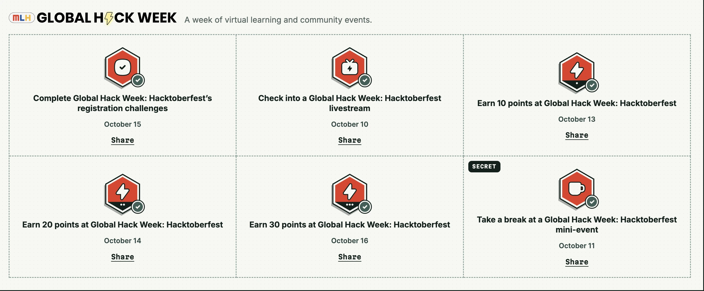
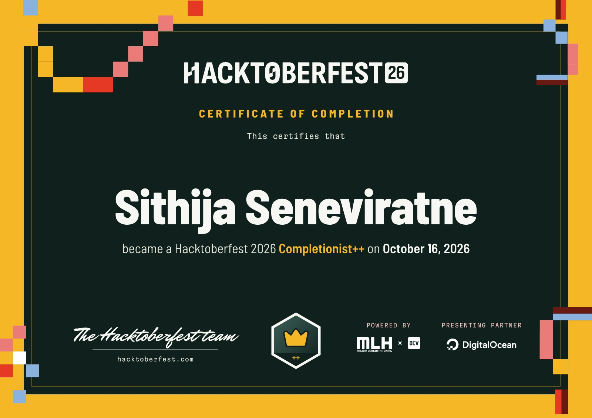
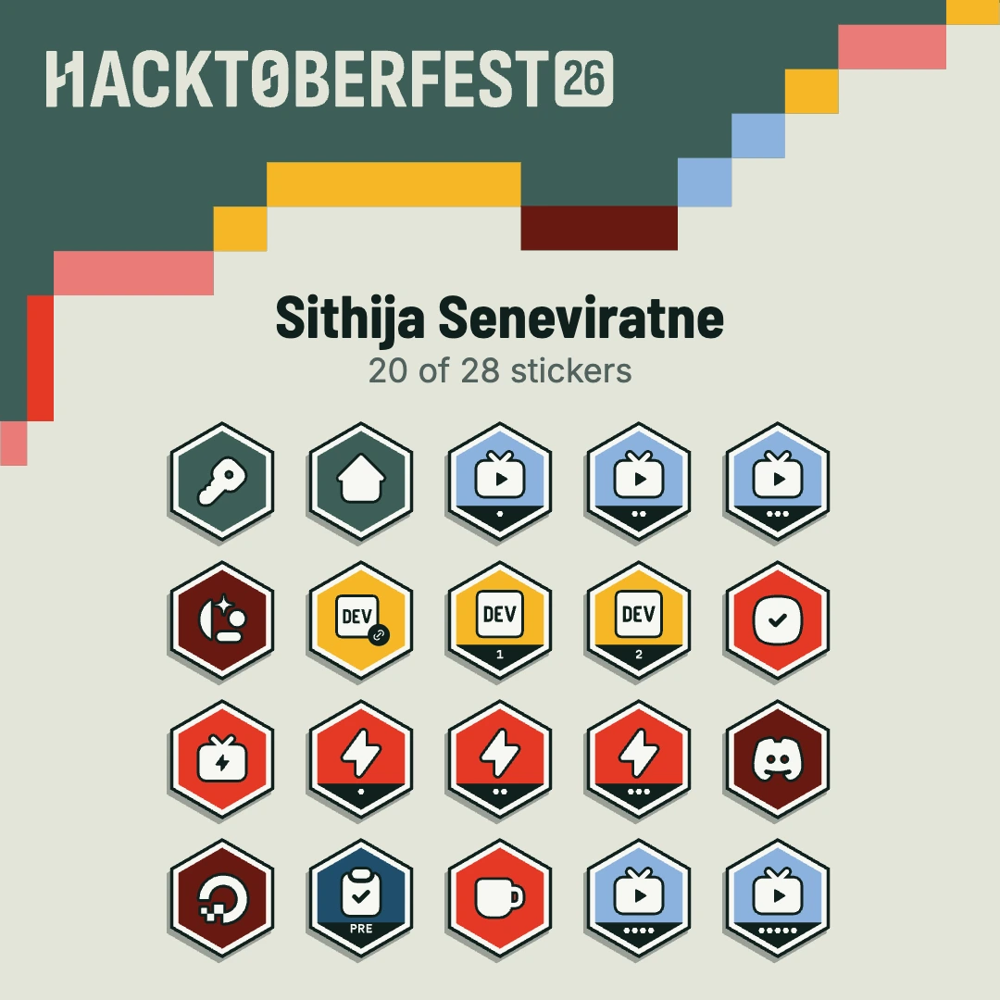

# Hacktoberfest 2026 🎃

A little sad to miss the PR system and merch this year… but hey, cool stickers still make me happy! 🥹✨

## Global Hack Week — 31 points! 🏆

[Codespaces](global-hackweek/skills-code-with-codespaces/) · [GitHub Copilot](global-hackweek/skills-getting-started-with-github-copilot/) · [Repository management](global-hackweek/skills-introduction-to-repository-management/)

## Two DEV challenges, two little adventures 🚀

- [Schedule-Up](Schedule-Up/) — WhatsApp & Telegram commitments, tasks, and safe follow-ups. [Read the story](https://dev.to/sithijaseneviratne/the-most-expensive-task-manager-for-a-side-hustle-is-the-one-in-your-head-31h9).
- [ShadeWindow](ShadeWindow/) — a little shade, a better walk. [Read the story](https://dev.to/sithijaseneviratne/shadewindow-a-little-shade-a-better-walk-16en).

## Proof I showed up (and collected stickers) 🎓📚

